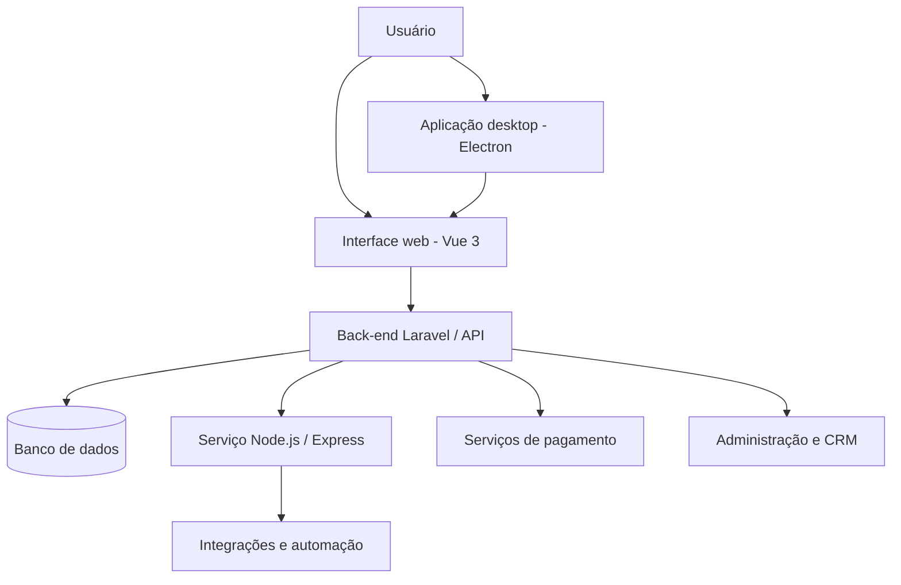

# 🎰 Maestro da Roleta

**Plataforma web e desktop de acompanhamento, gerenciamento e automação de rotinas relacionadas a jogos de roleta.**

**Projeto demonstrativo | Portfólio profissional**

---

## 📌 Sobre o projeto

O **Maestro da Roleta** reúne aplicações web, componentes de interface e serviços de integração em uma arquitetura voltada ao gerenciamento de usuários, controle de acesso, acompanhamento de sessões e rotinas de automação.

O projeto demonstra experiência em desenvolvimento **Full Stack**, integração entre tecnologias, organização de serviços e construção de interfaces administrativas.

> **Este é um repositório exclusivo de portfólio.** O código-fonte completo, configurações operacionais e regras de negócio permanecem em repositório privado. Não há dados de usuários, credenciais ou sessões de autenticação neste repositório.

## 🧩 Principais módulos

- **Interface web:** navegação, painéis e componentes interativos implementados com Vue.js.
- **Back-end:** autenticação, rotas, APIs e regras de acesso usando Laravel.
- **Integrações e automação:** serviços Node.js, Express e Puppeteer.
- **CRM e administração:** áreas administrativas e gerenciamento de usuários.
- **Planos e pagamentos:** recursos de controle de acesso e integração a serviços de pagamento.
- **Aplicação desktop:** empacotamento com Electron.
- **Persistência:** acesso a banco de dados relacional e migrações.

## 🛠️ Tecnologias

| Camada | Tecnologias |
|---|---|
| Back-end | PHP, Laravel, Laravel Sanctum |
| Front-end | Vue.js 3, Vite, JavaScript, HTML, CSS, Tailwind CSS |
| Serviços | Node.js, Express, Puppeteer |
| Desktop | Electron, electron-builder |
| Banco de dados | MySQL |
| Integrações | APIs REST, serviços de pagamento |
| Desenvolvimento | Git, Composer, npm |

## 🏗️ Arquitetura — visão geral

Diagrama conceitual: resume os componentes identificados sem expor detalhes internos ou credenciais.

## 🖼️ Demonstração visual

As capturas de tela serão disponibilizadas aqui após a seleção de imagens sem dados pessoais, identificadores de contas ou informações financeiras.

## 🔒 Código-fonte

A implementação completa é **proprietária** e não é distribuída publicamente. Este repositório documenta o projeto para fins de apresentação profissional.

## 👨‍💻 Desenvolvimento

Projeto desenvolvido como parte do portfólio de soluções web e desktop.

**Portfólio no GitHub:** [mauricioapacheco](https://github.com/mauricioapacheco)

---

<strong>Documentação pública · Sem código-fonte proprietário</strong>

